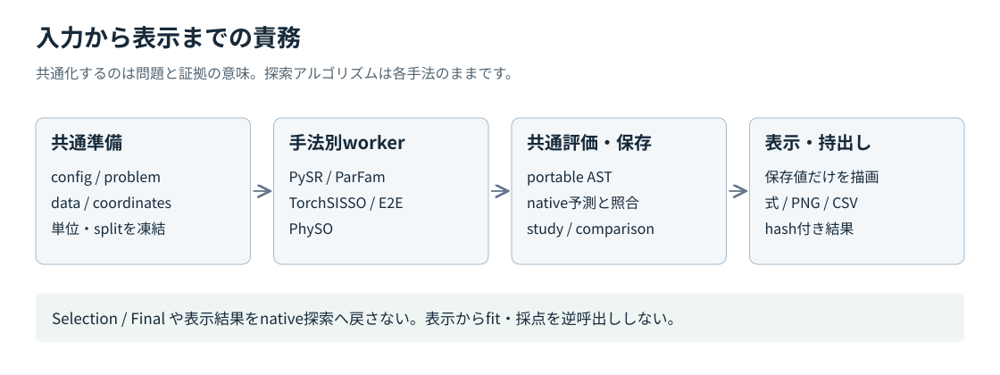
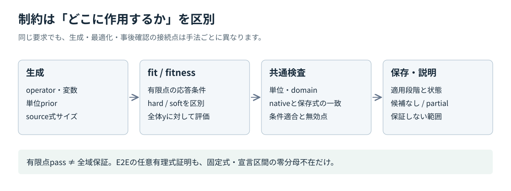

# 関数同定基盤 開発者仕様書

対象: `ml-platform-symbolic 0.90.4`。通常の中心手法は PySR / ParFam / TorchSISSO / E2E / PhySO。
操作手順は[ユーザーマニュアル](user_manual.md)、変更方針は[AGENTS.md](../AGENTS.md)を参照します。

本書では、**公式手法の原理**、**本基盤の実装**、**限定された実証**を区別します。共通化するのは入力・保存・評価の意味で、探索アルゴリズムではありません。記載した運用上の効果は設計と実装から分かる効果であり、工数削減率や全データでの性能改善を測定した主張ではありません。

## 1. 背景と目的

通常の回帰は形を決めて係数を推定します。関数同定では構造も未知になり、表現力・計算量・精度・解釈性を同時に扱います。シンボリック回帰には式木進化、関数族の連続最適化、疎記述子探索、事前学習提案、単位誘導生成など異なる方式があります。[PySR論文](https://arxiv.org/abs/2305.01582)、[ParFam論文](https://arxiv.org/abs/2310.05537)、[TorchSISSO論文](https://arxiv.org/abs/2410.01752)、[E2E論文](https://arxiv.org/abs/2204.10532)、[PhySO論文](https://arxiv.org/abs/2303.03192)。

個別ライブラリを並べるだけでは、列・単位・複雑度・失敗・制約段階・評価行が揃いません。本基盤は一つの要求から各native手法へ接続し、元の問題の意味を保持して共通評価へ戻すことを目的とします。特定のモデルを常に勝者にする設計ではありません。

### 従来の接続・運用上の問題と本実装

| 問題 | 本基盤の工夫 | 実務上できること / 残る限界 |
| --- | --- | --- |
| 手法ごとに列・単位・splitを作り直す | prepareでschema、座標、ID、群、分割、要求を凍結 | 同じ入力条件で再実行できる。誤った科学的仮定までは検出しない |
| 制約を出力フィルターだけで「対応」と呼ぶ | 生成、fitness、係数fit、事後評価を区別し、非対応併用を事前拒否 | 実際の適用段階を判断できる。有限点は全域保証ではない |
| 正規化後の小さな式と元座標の式を混同 | 元入力座標のASTで共通複雑度を計上 | 換算・外枠を含む同じ尺度で比較。native token数とは一致しない |
| 表示文字列の丸めで予測が変わる | native構造と全精度係数をportable ASTへ変換し独立予測照合 | 保存後の再予測が可能。有限点一致は全域同値証明ではない |
| 計算失敗や無効行が集計から消える | failed / partial / OOM / timeout / 不適格を保持 | 成功例だけの報告を避ける。候補回収は収束・再開ではない |
| Finalや描画の段階で選び直す | Train探索、Selection代表固定、明示Final、保存値のみ描画 | 情報漏洩と結果の変動を抑える。既露出Finalは未知testへ戻せない |
| native環境がないと結果を読めない | data-onlyの式・評価・図表、hash付き保存 | scalar式の推論にnative/checkpoint不要。外部拡張は明示導入が必要 |

## 2. アーキテクチャと責務

コードの基準ディレクトリは `pkgs/symbolic/src/ml_platform_symbolic/` です。

| 責務 | 主な所有元 | 入出力・境界 |
| --- | --- | --- |
| CLIと通常起動 | `__main__.py`, `scripts/run_linux.py`, `scripts/container_stage.py` | profile/資源/新規出力を指定。`--compare`は採用・Finalをしない |
| 厳密入力と事前確認 | `config.py`, `input_review.py`, `problem.py` | 重複キー・不正値を拒否。workerと同じ静的 `validate_request` |
| データ準備・凍結 | `data.py` | CSV/ID/群/split、Train/Selection/Final、hashを保存 |
| 単位・座標・領域 | `units.py`, `coordinates.py`, `domains.py` | 元membership、凍結変換、working座標。変換でdomainを消さない |
| native探索 | `engines/<method>.py`, `engines/runner.py`, `engines/worker.py` | Trainだけを渡し、予算・状態・native成果を回収 |
| native変換と照合 | 各adapterと `engines/symbolic_tree.py` 等 | 固定/自由/共有係数、operator、全精度をportable表現へ |
| 明示係数推定 | `estimation.py` | 元候補を変えない別fit variant。推定器と制約を記録 |
| 共通評価 | `equation_evaluation/`, `metrics.py` | 凍結subject/view/条件で数値・指標を保存 |
| 比較・用途判断 | `equation_comparison.py`, `selection.py` | 保存候補の比較と明示decision。探索へ順位を返さない |
| 保存 | `hypothesis_storage.py`, `model.py`, `portable_results.py` | schema/hash/参照を検証。新規writerと旧readerを区別 |
| 式・図・表 | `report_data.py`, `reporting.py`, `equation_output.py`, `figure_output.py` | 保存値だけを表示。再予測・fit・選択をしない |
| 任意外部連携 | `pkgs/spdml_layer` | 解析coreと分離。domain処理はClearML非依存 |

共有coreの固定commitは `91aa29a235527b9ecd6fc7f6d17101beb0cfe9a0`。optional依存は選択adapterでimportします。profile定義は `containers/profiles.json`、固定依存は `containers/requirements/` が正本です。

### 処理順と信頼境界

1. **validate / prepare**: 同じ準備処理で入力を検査。validateの一時成果は破棄し、探索や採点はしません。manifestのサイズ・hash検査はcheckpoint実行の証明ではありません。
2. **discover**: 凍結問題からTrain requestを作り、選択nativeのworkerを起動。異なる入力、予算、要求への部分patchは拒否します。
3. **export / check**: native表現を変換し、独立native oracleとportable予測をTrain・指定domain点・境界等で照合。失敗候補を成功式へ補正しません。
4. **study / compare**: 共通指標・適格性・source複雑度を保存し、比較します。通常launcherは手法/seedごとの適格なSelection RMSE代表を表示対象に固定します。
5. **outputs**: 保存された証拠のみを式/PNG/SVG/CSV/任意HTMLにします。
6. **choose / finalize**: 必要時だけ用途の許容条件を固定し、独立校正や最終監査へ進みます。Final後に候補を選び直しません。

## 3. 共通意味の仕様

### 3.1 座標・単位・複雑度

公開単位、working座標、native内部正規化を区別します。共通標準化は導入していません。手法が必要とするTrain-only正規化は保存式へ反映します。`value`と`difference`では単位のoffsetの意味が異なります。

`max_nodes`の共通尺度は、元入力座標へ換算・外枠・共有呼出しを反映した式ASTです。native token数、ParFamの圧縮storage、slot局所サイズ、PhySO生成系列容量とは別です。固定literal・指数・換算定数を自由係数へ変更しません。

`require_units`は共通適格性、`unit_search`は探索時利用の要求です。未知単位、係数単位の曖昧さ、角度/cycleを無次元と勝手に同一視しません。手法が扱う基本次元の整合性は、量の物理的意味や正しい法則の証明ではありません。

### 3.2 式とdomain

portable ASTは許可演算のdata-only表現です。任意文字列evalやartifact内codeの自動importをしません。保護演算とstrict-real中間maskは区別し、相殺で隠れた `0/0` やlogの不正引数を有効へ変えません。元membershipをchart前に検査し、affine混合後の集合を便宜的なboxへ置換しません。

未知slotが引数を使わなくなっても、その引数に非自明なdomain制約がある場合は単純消去できません。現在はこのようなexportを拒否します。外枠・固定値・共有関係は保存再読込でも保持します。

### 3.3 応答制約

新規入力の応答は `response_mode=search`、enforcement省略/nullはhardです。softは対応手法だけ、filterは明示した事後対照です。古い保存物は当時の意味を維持します。

探索点はユーザーの指定点を共有し、独立監査点は探索へ渡しません。domainからの自動有効性点は有限性・target.domainの確認用で、応答boundsを暗黙に全域化しません。微分は全差分stencilで元領域を検査します。

任意の点生成省略形は `requirements.required_responses.sampling` または各checkの `sampling`。全featureの公開単位box、明示seed、1〜4096の2冪のSobol点数、全頂点を賄うcorner予算0〜256を受理します。不足するcorner予算や空の差分中心領域は拒否。明示点を動かさず、生成点だけ重複を抑止し、宣言と点数をprovenanceへ保存します。有限点coverageは連続領域保証ではありません。

### 3.4 fit・評価・識別性

native fit、SLSQP、制約付き線形solve、明示推定器を一括してleast-squaresと呼びません。solver success、有限なbest点、制約適合、収束、大域最適は別です。元候補に明示refitした結果は別variantにします。

`linear_deming`は既知の独立・加法・等分散誤差比と2自由係数の明示線形関係に限定。非線形EIVや相関誤差への一般化はしません。係数boundsを超えた無制約解のclipもしません。

良いRMSEや単位整合だけでは `a*x+h(x)` / `f(x)+g(x)` の分解は一意になりません。局所係数診断は `parameter_evidence_ids` で明示した固定候補だけに計算し、未指定は `not_computed`。数値Jacobianのrankは刻み・scale・設計に依存し、大域識別性や有意性ではありません。

## 4. 5手法の原理と接続

### 比較表

| 手法・採用版 | 公式方式 | 長所を生かす場面 | 短所・本基盤の重要限定 |
| --- | --- | --- | --- |
| PySR 2.7.2 | 進化的な式木と定数最適化 | 演算構成が未知、複数の精度/複雑度候補がほしい | 確率探索と資源に依存。native Paretoと共通Paretoは別 |
| ParFam `e10379a…` | パラメトリック関数族の連続最適化と削減 | 多項式・有理式・指定関数が妥当 | 指定族外は対象外。非凸最適化、early stopで未訪問族が残る |
| TorchSISSO 0.1.8 | 特徴展開→SIS→疎線形fit | 少数記述子からなる関係を比較したい | 展開のメモリとheuristic screening。単位付き係数の自由な導入はない |
| E2E 固定model1 | Transformerが式と係数を提案→BFGS | 異なる提案分布を比較へ加えたい | 事前学習分布、1〜10入力、CPU。重みの再学習・一般単位誘導はしない |
| PhySO 1.1.11 | 単位prior付きRNN→定数fit→reward→更新 | 次元情報を構造探索へ使いたい | 定数単位catalogと資源に依存。priorの整合と物理正解は別 |

原理は文献[1]〜[5]、以下の接続・限定は本基盤adapterと回帰テストを根拠とします。論文の比較結果を本基盤の性能結果へ転用しません。

### 4.1 PySR

- 公式接続: operator、入れ子、引数サイズ、予算、Hall of Fame、`TemplateExpressionSpec`。式木と外側parameter vectorから保存し、文字列表示を再解釈しません。[公式固定版](https://github.com/MilesCranmer/PySR/blob/v2.7.2/pysr/sr.py)
- 基盤拡張: source予算gate、hard応答のInf fitness、soft有限罰則。`unit_mode=soft`は公式次元罰則、hardはfitness内で次元違反をInfにする厳格化で、生成文法による禁止ではありません。
- 定数単位: 公式既定の `dimensionless_constants_only=False` では自由係数はwildcard。一意に求まる通常式の係数基本次元だけを別途復元し、曖昧さをunknownとして保持します。templateへこの復元を一般化しません。
- 境界: template＋単位探索、template＋真の変数subsetは事前拒否。通常式の応答条件は元schemaで検査した後、native入力列だけを射影します。`unit_mode`未指定は従来の後判定ですが、共通 `unit_search:true` 要求時はhardへ解決します。
- 基盤既定: serial/deterministic、100 iterations、8 populations、population40。公式の品質推奨ではありません。soft重みはnative lossの尺度次第で相対強度が変わります。
- 中断: 通常式はrun identityと同世代CSV/backupを検証し、writer停止後にCSV-onlyで回収。pickleを読みません。回収はpartialで、template・旧markerなし・破損世代を救済しません。

### 4.2 ParFam

- 公式の多項式/有理式/指定関数族を使い、DL-ParFamの学習済み誘導とは区別します。採用commitは `e10379a0e19238b50178492c48da0d0444d4898f`。
- 基盤拡張: 族のsource予算をfit前に判定。`family_search=up_to` は低次数族を補完し、`fixed`と探索集合が異なります。hard応答は係数fit、pruning refit、family評価へ同じ有限点条件を適用します。softとunit_searchは未対応。
- 既知外枠: 単一shared-slot・外側固定係数を全体yに対するstrict-real予測へ接続。native族探索・共同係数fit・削減を維持します。複数slot、外側free、nested、input map、template＋subsetは拒否。
- 無次元規約: slot出力と全formalが明示unit1のときのみ、native由来未知係数へunit1を伝播。未知/次元付き/radを推測で補いません。
- 非有限autogradはlocal fit失敗。別hop/startは継続できますが、数値差分・epsilon・勾配ゼロ化へ無言に切り替えません。pruning失敗は直前の完了係数を保持。
- 基盤既定maxiter50/repetitions1。全Train受領とwinner調整5000行上限、native内部80/20と共通Selectionを区別。solve要求数・optimizer返値数・可行性・収束は別記録です。

### 4.3 TorchSISSO

- nativeの特徴展開、SIS screening、少数記述子の組合せ、線形fit、残差更新を維持します。[公式実装](https://github.com/PaulsonLab/TorchSISSO)
- 基盤拡張: descriptorのsource予算を標準化前、組合せ予算をsolve前へ適用。hard応答はscreening済み単項/多項subsetの制約付き線形fitと残差更新へ接続します。全中間特徴メモリの上限でも、全構造の網羅でもありません。
- 次元: `dimensional=true` はtarget次元の記述子を選ぶ方式で、係数無次元・切片target単位。任意の単位付き係数を追加しません。例えば密度と時間の乗除・べきだけから圧力へ次元到達しない問題は解決できません。
- 既知外枠: dimensional=true、既知非零scalar aの `b(x)+a*f(h(x))` に限定。`z=(y-b)/a` なら SSE_y = a² SSE_z で同じ最小化解を保ち、native SISを維持します。浮動小数の探索軌跡一致は保証しません。
- 単一composed引数または複数variable-leaf引数、同じ引数でのshared-slot反復を受理。非線形外枠、変数依存倍率、外側free、独立複数slot、異なる引数反復、nested、map/subset、softは拒否します。
- 既定 `n_expansion=2, n_term=3, k=10, dimensional=false`。全精度係数と記述子を保存。寄与を物理機構の重要度とは認定しません。

### 4.4 E2E

- 固定公式commit `c4144c99d078dd611795338e24fb3da49a32b9d8`、model1を使用。式と係数の提案→native NoRef/BFGS。事前学習重みを利用し、入力データで再学習しません。[公式固定README](https://github.com/facebookresearch/symbolicregression/blob/c4144c99d078dd611795338e24fb3da49a32b9d8/README.md)
- 全Trainの固定正規化、200点以下のbag、microbatch生成、全候補統合、native順位/重複除去/refinement。BFGSはdownsample=-1。bagサイズは総行数上限ではありません。`max_train_rows=1024` はguard、nullで全行を明示。threads/microbatch変更は同seedでも候補を変え得ます。
- 基盤拡張: prefix構文、変数参照、source予算、既定operator_maskを生成へ適用。演算maskを明示falseにした経路は事後判定対照です。禁止変数tokenの抑止はencoderからその列を除くこととは異なります。
- hard応答: export/parityを通った全供給候補に元yのSLSQP係数fit variantを作り、NoRef/BFGS原本と別lineageで保存。decoderは応答条件付きではありません。整数literal・scaler定数を自由化しません。
- 既知外枠: `y=b(X)+a*h(X)` の固定非零a、単一slot、全X同順の同一呼出し、明示unit1、unit-cost source座標だけ。厳密なslot観測をnativeへ渡し、外枠は組立/元y係数fitへ適用。任意templateではありません。
- 任意 `rational_domain_admission`: **1元有理AST＋有限点hard応答search**だけ。元座標の宣言閉区間で全中間分母非零を厳密判定し、実訪問した改善係数の保持と最終受理へ使います。decoderやSLSQP目的を区間条件化しません。safeは零分母不在だけで、IEEE有限性・全域単調性・可行解発見を保証しません。
- この追加は既定無効。`column`, `interval`, `max_calls`, `max_total_operations` の全指定が必要。unknown/unsafe/out_of_scopeをsafeにせず、未証明原候補へfallbackしません。探索全体で証明予算を共有し、最終再検査も消費。1呼出し上限はノード256、次数32、整数4096bit、20000有理演算charge。domain単独、filter、複数元入力、他4手法、比較時再fitとの併用は未対応です。
- 証拠は区間・単位・固定係数式hashと保存し、load/predictで再証明しません。係数を変更した別variantへ証明を継承しません。

### 4.5 PhySO

- RNN生成→定数fit→reward→RNN更新のループを維持。単なるランダム式生成ではありません。入力/出力/固定・自由定数の次元をPhysicalUnitsPriorへ渡します。native priorのnonzero epsilonを絶対保証とは呼びません。[公式機能資料](https://physo.readthedocs.io/en/latest/r_features.html)
- 基盤拡張: source予算のweighted prefix priorをsampling前へ適用。hard応答は各完成・単位適格候補の共通SLSQP fit→native定数へ書戻し→予測/適合確認→reward→RNN更新。公式LBFGSの明示置換で、生成文法の応答条件化ではありません。softは拒否。
- 既知外枠: 公式candidate_wrapperを利用。単一native programと係数tensorを共有し、全体の元yへfit/rewardを計算。外側固定係数、元schemaと同じ仮引数名/順序/canonical単位、variable-leaf呼出しに限定。
- strict-real中間mask、非有限勾配でlocal fit失敗は独自拡張。固定source hashを確認しsequential worker内だけ補正、終了時に復元。複数slot、外側free、nested、composed引数、map/subset、templateのrootn、thread/reentrant利用は対象外。
- 既定lightweightはconfig0由来batch128/epochs5/max_n_evaluations2000。公式batchはconfig0=1000、config1=10000、config2=2000、公式epochsは全て1e9。config1/2は有限予算の明示を要求。presetを無変更で実行したとは表示しません。
- 優先順: preset→lightweight互換値→明示options→source/演算prior調整→CPU/thread。elite数 `int(batch_size*risk_factor)` が0の設定は事前拒否し、batch/riskを自動調整しません。
- `max_time_step` 未指定はsource max_nodesと同値。明示値はclipせず系列容量とHardLength上限へ反映し、source/slot予算は別に維持。T=1のnative min0と実効AST最短1を区別。horizon変更は探索条件の変更です。
- 汎用不要保持の除去とint32表現圧縮は小比較で値/RNG/勾配/候補/保存を照合した限定実証。別8GiB試験の50epoch/100k生成・約6.37GiB peakの完走例を、全データの必要RAMへ一般化しません。元6GiB試験はOOM未完のままです。

### 4.6 共通の変数制限と任意経路

ParFam/TorchSISSO/PhySOはallowed_variablesに従いnativeへ渡す列を探索前に除外します。元schema順とIDを保持し、共通domain・条件stencil・保存推論は全schemaを使います。「禁止列をファイルから一切読まない」保証ではありません。0列、input map、template＋subsetは未対応。PySRとE2Eの差は前記の通りです。

mean/linearは基準、known_formはslotなしの係数推定、template_enumerationはcoreの有限AST文法です。`e2e_template/flash_template/rasr_template`は別名のheuristic複合variantで、通常nativeのtemplate対応ではありません。任意profileの総当たりや機能数合わせを通常運用の目的としません。

## 5. 出力・保存・互換性

描画層は保存済みの式・数値・無効mask・条件を表示し、探索や採点を逆呼出ししません。数式はグラフと分け、長式の完全TXTと元CSVを残します。単一系列は黒、多系列は手法色と線種を対応させ、等アスペクトの観測対予測、整数ノード目盛、明示offset/対数目盛を使います。ゼロをepsilonへ置換せず、無効点を跨ぐ線を引きません。通常出力は候補別/pair別で、保存pairから一部だけを隠れて描く制限を設けません。共通pathのidentityがなければ応答を重ねません。代表表示で原候補を削除せず、読込メモリ一定も保証しません。

比較のsubjectはrelation参照・state hash・view・settingsを含み、同じ文字列表現でも値・残差・ensemble分位を混ぜません。RMSE/MAE/R²、finite率、適格性、native目的、source複雑度は別指標です。

| 保存対象 | 対応形式 |
| --- | --- |
| scalar bundle | manifest 1/2。geometry付き新規は2 |
| equation | schema1 tree、schema2共有表現・算術tag・template |
| ensemble / implicit | 各schema1の専用loader |
| evaluated prediction / prepared problem | schema1/2、named view・geometry・固定subject |
| prediction interval | schema1、固定predictorと幅unit |
| study | manifest1/2/3。新規3はhypothesis_pool1 |
| portable result | frozen_equation_result schema1 |

未知version、不正hash、欠損/重複member、矛盾参照を拒否。旧artifactは元の意味で読み、再sealやFinal履歴変更をしません。hypothesesの共有contextはcanonical JSON bytes完全一致で、bool/int/float/符号付きzeroを混同しません。公開loaderは独立辞書へ復元するeager方式です。

writerは同directory一時file→flush/fsync→atomic replace、manifestは証拠完了後に作成。pendingやmanifestなしは完成studyではありません。任意OS・ハード障害のtransaction保証ではありません。Windows bindの旧rename PermissionErrorは原因未特定で、別PNG経路の成功を恒久修復の証明にしません。

`export_result`は元checkoutなしで読むdata-only結果ですが、評価点・残差等を含みます。raw観測全体・asset・extensionコード・全解析依存は自動収集しません。readout-onlyは予測器なしを明示しpredictを拒否します。予測区間と採用判断は同じ固定候補・区間hashへ結び付けます。

## 6. 検証・拡張・運用

### 検証の層

| 層 | 確かめること | 証明しないこと |
| --- | --- | --- |
| 入力・fast回帰 | 不正値、漏洩、domain反例、固定係数、保存互換 | native実行・探索品質 |
| 小native機構試験 | 実入力、制約のnative伝播、独立oracle、保存後predict | 広い実データ有用性 |
| 固定比較実験 | 指定データ/分割/seed/予算の性能・状態 | 他条件の優位性・因果識別 |
| installed/image確認 | import root、source/wheel/image/asset一致 | 別OS/GPUの再現性 |
| 図の受入確認 | 全ラベル、欠測/無効表示、元CSV、数式、保存値忠実性 | 統計的・科学的結論 |

通常fast試験は `python scripts/run_linux.py --build -- python -m pytest tests -q`。nativeは固定profileと準備済み資産のもとで明示 `-m native`。詳細は [tests/README.md](../tests/README.md)。passed/failed/skipped/未実施を別に報告し、件数を品質の目的にしません。

固定15試行の13 ok / 2 PhySO partialは、後続の単位・domain・メモリ・horizon修正前の凍結結果です。元代表/Finalを変更していません。修正後の比較性能は新しい凍結実験が必要です。全native/GPU clean build、全外部接続、広い実データ品質は一括検証済みではありません。

### adapterを追加・変更する

1. 固定nativeの接続点とユーザーの要求を確認し、`capabilities / validate_request / discover` と明示registryへ実装する。
2. 既存runner/worker/checked_candidate/保存評価を再利用し、新しい汎用階層や代替fallbackを増やさない。
3. requestのX/y/row_idsはTrainだけ、列順はvariables、単位は解決済み。二重変換しない。
4. 不正併用の事前拒否、nativeへの実伝播、独立数値照合、保存再読込、異なる問題構造の小試験を追加する。
5. 本書とユーザーマニュアル、該当実行例を同時更新。機構確認と性能評価を分ける。

外部extensionは同module/version/sourceを `register_runtime_extension` で明示登録します。単独register_engineは別workerへの導入ではありません。helperは `__implementation_files__` で宣言し、保存artifactからcodeを自動導入しません。

### 配布・更新

既存変更へreset/cleanをかけません。source、wheel、実行imageの版名だけで一致を推測せず、manifest/hash/import rootを照合します。source exportは `scripts/export_source.py` のallowlistを使い、実測data・結果・weights・runtime・cache・秘密を混ぜません。source/依存の権利とNOTICEを保持し、checkpoint再配布権限を推定しません。

lean offline bundleはnative/Julia/GPU/checkpointを含みません。Linux x86-64 / Python3.11 / glibc2.28以上向けで、Windows PythonへLinuxwheelを導入しません。`MANIFEST.json / RELEASE_STATUS.json / NOTICES / THIRD_PARTY.json`を確認します。

## 7. 根拠・参考文献

一次資料は原理を説明する根拠です。実際に採用した版・独自patch・機能境界は本リポジトリの固定依存、adapter、テストとrun manifestで確認します。latest/mainの資料を固定版の実行証明にしません。以下は2026-11-16に参照確認しました。

1. Miles Cranmer (2023), *Interpretable Machine Learning for Science with PySR and SymbolicRegression.jl*. [論文](https://arxiv.org/abs/2305.01582) / [固定2.7.2 source](https://github.com/MilesCranmer/PySR/blob/v2.7.2/pysr/sr.py)。式木進化と科学計算向けSRの背景。
2. Philipp Scholl, Katharina Bieker, Hillary Hauger, Gitta Kutyniok, *ParFam: (Neural Guided) Symbolic Regression Based on Continuous Global Optimization*. [論文](https://arxiv.org/abs/2310.05537)。連続パラメトリック族の原理。本基盤の採用版は上記commitであり、論文中の全variantを実装した主張ではありません。
3. Madhav Muthyala, Farshud Sorourifar, Joel A. Paulson (2024), *TorchSISSO*. Digital Chemical Engineering 13, 100198. [論文](https://arxiv.org/abs/2410.01752) / [DOI](https://doi.org/10.1016/j.dche.2024.100198) / [公式source](https://github.com/PaulsonLab/TorchSISSO)。特徴展開・SIS・疎回帰の背景。GPU性能の論文結果を本基盤CPU運用へ転用しません。
4. Pierre-Alexandre Kamienny, Stéphane d'Ascoli, Guillaume Lample, François Charton (2022), *End-to-end symbolic regression with transformers*. [論文](https://arxiv.org/abs/2204.10532) / [固定source README](https://github.com/facebookresearch/symbolicregression/blob/c4144c99d078dd611795338e24fb3da49a32b9d8/README.md)。式と係数の同時提案、後段refinementの原理。
5. Wassim Tenachi, Rodrigo Ibata, Foivos I. Diakogiannis (2023), *Deep symbolic regression for physics guided by units constraints*. ApJ 959, 99. [論文](https://arxiv.org/abs/2303.03192) / [DOI](https://doi.org/10.3847/1538-4357/ad014c) / [公式機能資料](https://physo.readthedocs.io/en/latest/r_features.html)。単位制約付き生成・強化学習とwrapper接続の背景。

実装根拠の入口: [入力検査](../pkgs/symbolic/src/ml_platform_symbolic/input_review.py)、[準備](../pkgs/symbolic/src/ml_platform_symbolic/data.py)、[adapter群](../pkgs/symbolic/src/ml_platform_symbolic/engines/)、[比較](../pkgs/symbolic/src/ml_platform_symbolic/equation_comparison.py)、[描画](../pkgs/symbolic/src/ml_platform_symbolic/figure_output.py)、[固定依存](../containers/requirements/)、[テスト責務](../tests/README.md)。
