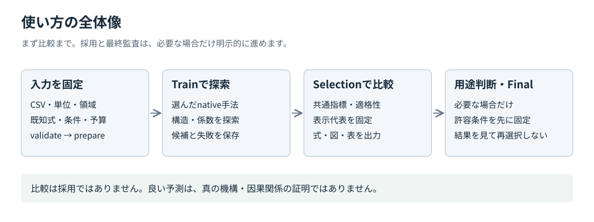

# 関数同定基盤 ユーザーマニュアル

対象: `ml-platform-symbolic 0.90.4` の現行source。実際の実行版はrunのmanifestで確認します。

本基盤は、データから数式候補を探し、同じ分割・単位・指標で評価し、式とグラフを比較する道具です。**予測が良い式を、真の機構や因果関係と自動認定するものではありません。** ブラウザー入力フォームはなく、JSON/YAMLまたはPython APIを使います。

- 初回利用: 1 → 2 → 3 → 5 → 6
- 自分のデータ: 3 → 4 → 5
- 結果の考察: 6 → 7
- 実装・各手法の制約・出典: [開発者仕様書](developer_spec.md)

## 1. 何をする基盤か



| 段階 | すること | しないこと |
| --- | --- | --- |
| 入力確認 | 列、ID、単位、domain、split、手法の静的対応、資産hashの確認 | 探索成功やGPU可用性の保証 |
| Train | 前処理の学習、構造探索、係数fit | Selection/Finalを探索教師へ戻すこと |
| Selection | 同じ条件で候補を採点し、表示代表を固定 | 科学的な正解の認定 |
| 比較・出力 | 保存された式、指標、応答、残差の表示 | 描画時の再fit・再選択 |
| 用途採用・Final | 必要な場合だけ判断を固定して最終監査 | Finalを見て選び直すこと |

通常は固定holdout・1seedで開始します。mean/linearは基準比較です。5手法すべてや多seedを毎回実行する必要はありません。

## 2. 導入と最小実行

リポジトリ直下で実行します。WindowsホストではPythonのlauncherから**Linux Docker**を使用します。ホストPythonは起動用で、数値計算はコンテナー内です。Dockerが利用できることが前提です。

```powershell
python scripts/run_linux.py --profile core --build -- python examples/basic.py --output results/basic
```

これは小さな合成例の動作確認です。5手法の精度試験ではありません。毎回新しい出力名を使い、完了状態・数式・PNG・CSVを確認します。

| profile | 通常の用途 | 準備 |
| --- | --- | --- |
| `core` | 入力確認、基準モデル、共通評価と表示 | `--profile core --build` |
| `classic` | PySR、ParFam、TorchSISSO、PhySO | `--profile classic --build` |
| `e2e` | E2E Transformer | imageと固定モデル資産 |

classicの準備例:

```powershell
python scripts/run_linux.py --profile classic --build -- python -m ml_platform_symbolic --version
```

E2Eを使うときだけ、利用条件を確認して資産を明示取得します。

```powershell
python scripts/run_linux.py --profile e2e --build --setup-network --output-root pretrained -- python scripts/setup_e2e_assets.py
```

設定に `"model_assets":{"e2e":{"manifest_file":"pretrained/e2e/manifest.json"}}` を指定します。通常探索がモデルを自動ダウンロードすることはありません。

launcherはプロジェクトを読取専用、指定出力先を書込可能にし、通常探索のネットワークを無効にします。現行のCPU上限は4、メモリ既定は10gです。必要なら `--memory 8g` のように明示します。これは必要メモリや完走の保証ではなく上限です。初回buildにはネットワークとディスク容量が必要です。全profile/GPUのclean buildを一括確認済みとはしません。

## 3. データと設定

### 3.1 最初は同梱の入力例を確認する

```powershell
python scripts/run_linux.py --profile core -- python -m ml_platform_symbolic validate examples/input/input_demo.json
python scripts/run_linux.py --profile core -- python -m ml_platform_symbolic engines pysr
```

[input_demo.json](../examples/input/input_demo.json) はCSV・splitと組で使うlinear/filter例です。単位変換と入力確認の例であり、制約付き探索の主例ではありません。`engines NAME` で受理するoption名と能力を確認できます。

`inputs_valid` は共通入力と実装済み静的検査の通過です。ライブラリ起動、checkpointの実行、探索完了を意味しません。`blocked` は表示された理由を修正して再確認します。validateはFinalの整合性も検査しますが、予測・採点はしません。

### 3.2 自分のCSVで変更する箇所

| 項目 | 指定する内容 | 注意 |
| --- | --- | --- |
| `data.local_path` | CSVの場所 | 相対pathは実行directory基準 |
| `data.feature_columns` | 入力列名の配列 | 順序も固定。target、ID、groupを除く |
| `data.target_column` | 目的変数1列 | 現行の通常予測はscalar出力 |
| `data.units` | CSV数値の単位 | `null`は未知、`"1"`は無次元。別の宣言 |
| `data.coordinate_roles` | `value` / `difference` | 絶対温度と温度差を区別 |
| `data.domain` | 列ごとの `[下限,上限]` | 新規入力はCSVの単位。観測範囲と別 |
| `split.file` | `sample_id,partition` のCSV | 全IDを過不足なく一度ずつ |
| `split.group_column` | 実験・設計・個体等の群 | 同じ群を複数partitionへ分けない |
| `search.engines` | 使用する手法 | 選択しない手法のoptionsは置かない |
| `search.engine_options` | 手法名ごとの個別予算 | 共通条件と混ぜない |
| `requirements` | 演算、複雑度、単位、既知式、応答条件 | 手法ごとの対応を確認 |

CSVに一意な `sample_id` を付けます。先頭ゼロを含むIDは文字列として保持されます。数値の空欄、非有限値、重複列、ヘッダ幅を超える余分なフィールドは自動修復や行削除をせず拒否します。JSONの重複キー、NaN/Infinityも拒否します。UTF-8 BOM付きJSONは使用できます。

固定splitは `train` / `selection` / `final` を使い、いずれも空にしません。固定splitがなければ次を指定できます。

```json
{"split":{"method":"group","group_column":"batch","seed":42,
          "valid_size":0.2,"selection_size":0.25}}
```

`valid_size` は全群のうちFinalへ割く割合、`selection_size` は**Finalを除く残りの群**に対する割合です。群数の切上げと群サイズにより行数割合は一致しません。validateで件数を確認し、prepareで凍結します。

### 3.3 範囲を区別する

- **Trainの観測範囲**: 何を学習したか。予測の許可範囲ではありません。
- **`data.domain`**: 予測を有効とする宣言範囲。外側の点は無効として保持します。
- **応答条件点**: 値や傾きを検査・制約する明示的な有限点。
- **独立監査点**: 探索へ渡していない確認点。探索条件点の再確認と区別します。

外挿性能を調べる点は、Train範囲の外でも宣言domain内に置きます。domain外での拒否は精度試験ではありません。入力mapや単位変換を使う場合も、元の領域と全差分点を保持します。

## 4. 手法・条件・予算を選ぶ

### 4.1 5手法の役割

以下は試す順序を決める目安で、性能順位ではありません。原理・公式資料と実装上の限定は[仕様書の手法比較](developer_spec.md#4-5手法の原理と接続)を参照してください。

| 手法 | 試す理由 | 主な弱点・確認点 | 個別設定の例 |
| --- | --- | --- | --- |
| PySR | 式木の広い組合せや未知関数を探索 | 計算量・乱数・演算文法に依存 | `niterations`, `populations` |
| ParFam | 多項式・有理式・指定関数族の係数探索 | 指定族の外は探せず、非凸fitや初期値に依存 | `degree`, `maxiter`, `repetitions` |
| TorchSISSO | 少数の記述子で説明する疎な式 | 特徴展開のメモリ、screeningの取り逃し | `n_expansion`, `n_term`, `k` |
| E2E | 事前学習モデルの提案を比較に加える | 学習分布・モデル資産に依存。CPU、1〜10入力 | `beam_size`, `n_trees_to_refine` |
| PhySO | 単位情報を式生成へ使う | 自由定数の単位catalog、生成長・RAMに依存 | `profile`, `epochs`, `max_n_evaluations` |

共通形式でも探索空間は同一になりません。比較には同じデータ・分割・評価条件を使い、各手法に適した予算と実際の使用行数を記録します。一律の短いtimeoutだけで精度限界を判断しません。

### 4.2 通常設定の変更例

次は既存の完全設定に入れる**部分例**です。

```json
{"search":{"engines":["pysr","parfam"],"seeds":[42],
  "max_wall_seconds":300,"candidate_pool_policy":"all",
  "allow_partial_engines":true,
  "engine_options":{"pysr":{"niterations":100,"populations":8},
                    "parfam":{"degree":2,"maxiter":100,"repetitions":2}}}}
```

`max_wall_seconds` は各engine/seedの上限です。数値は書式例で、推奨品質を保証しません。`all` はexport上限で候補を隠れて削らない指定です。意図的な候補数制限には `pareto_diverse` と上限を明示します。`allow_partial_engines` は未完了を残して比較する指定で、別手法による救済ではありません。

PhySOの既定 `lightweight` は小さい互換設定です。通常用の `config1` / `config2` では有限の `epochs` または `max_n_evaluations` を明示します。例えば `{"profile":"config2","epochs":50,"max_n_evaluations":100000}`。これは予算例で、精度・RAMの推奨値ではありません。`max_time_step` の変更は探索条件自体の変更です。

E2Eの `max_train_rows` 既定1024は資源guardです。`null` は全Train利用の明示指定であり、200点のbagサイズと総行数上限は別です。モデルへの重み再学習は行いません。

### 4.3 単位・既知式・応答条件

| 要求 | 意味 |
| --- | --- |
| `allowed_operators`, `max_nodes` | 使用演算と、元入力座標に展開した式のASTノード上限 |
| `allowed_variables` | 使用を許す元列名。手法別の探索入力制限を確認 |
| `require_units` | 共通評価で単位適格性を要求 |
| `unit_search:true` | 探索時にも単位を利用する必須要求。非対応なら事前拒否 |
| `fixed_constants` | 値とunitを固定し、fitで変更しない定数 |
| `equation_template` | 固定外枠、未知slot、固定/自由/共有係数の宣言 |
| `required_responses` | 指定点での値範囲や有限差分の符号等 |

`require_units` だけでは全手法が次元制約付き探索になりません。ParFam/E2Eの一般的な単位誘導は未対応です。未知単位を偽のunit1へ変えて実行しません。

形が完全に既知で係数だけ未知なら `known_form`、一部の関数が未知ならtemplateを使います。[Python例](../examples/partial_equations.py)から始めてください。templateはworking座標の `x0,x1,...` 順で記述します。CSVのcmをmとして使わないようvalidateの変換を確認します。同じslot名は同じ関数・係数を共有します。

応答条件の部分例:

```yaml
requirements:
  required_responses:
    enforcement: hard
    points: [{x: 0}]
    bounds: [0.99, 1.01]
search:
  response_mode: search
```

新規要求の既定は `search` / `hard` です。条件を探索の生成・fitness・係数fitのどこへ渡すかは手法ごとに異なります。softに対応しない手法は拒否します。`filter` は明示した事後判定対照です。要求を満たさない実装へ無言で切り替えません。

微分条件は方向またはfeature、order、step、tolerance、pointsを明示します。全入力列を含む有限点を指定し、差分stencilもdomain内に置きます。任意の条件点生成には `sampling` が使えますが、Sobol点や全頂点も連続領域の保証にはなりません。設定詳細・E2Eの限定的な区間証明は仕様書を参照してください。

prepare後に単位・条件・予算を部分的に差し替えることはできません。変更時は同じ固定splitを用いた別prepare・新しいrunにします。

## 5. 探索と比較を実行する

```powershell
python scripts/run_linux.py --profile core -- python -m ml_platform_symbolic validate my_problem.json
python scripts/run_linux.py --config my_problem.json --run-dir results/my_run/calculation --compare
```

`my_problem.json` は自分の完全設定です。`my_run` は未使用名にします。`--compare` のとき末尾は `calculation`。既定出力rootは `results` です。探索だけなら `--compare` を省略します。

公開データを使う場合は、比較を始める前に明示取得・分割を準備します。

```powershell
python scripts/run_linux.py --profile core --setup-network --output-root data -- python scripts/prepare_validation_data.py --dataset yacht --out data
```

`--dataset` は `airfoil` / `concrete` も選べます。既存source.zipを使うときは `--offline` を追加し、ネット取得をしません。Concreteのxls読込だけpandas/xlrdが必要です。比較途中で既存表・splitを上書きしないでください。metadata.jsonに出典、source/table/split SHA、派生列・群の定義を記録します。列の厳密一致から作る群は、実際の船型/実験IDの独立性を保証しません。既露出/履歴不明のFinalと事前学習重複unknownを保持します。

公開入力の出典はUCIの [Yacht](https://archive.ics.uci.edu/dataset/243/yacht+hydrodynamics)、[Airfoil](https://archive.ics.uci.edu/dataset/291/airfoil+self+noise)、[Concrete](https://archive.ics.uci.edu/dataset/165/concrete+compressive+strength)（CC BY 4.0）です。Yachtは無次元、Airfoilのtarget dBは圧力Paと同じ次元ではありません。Concreteは配合kg/m³・材齢day・target MPaです。比較に通すため偽の単位を付けず、単位から未知機構を推定しません。

5手法を使う実例は [benchmarks/yacht/main.json](../benchmarks/yacht/main.json) です。データ・固定分割・classic/e2e/core image・E2E資産を準備してから実行します。

```powershell
python scripts/run_linux.py --config benchmarks/yacht/main.json --run-dir results/yacht-main/calculation --compare
```

この設定は開始例で最良設定ではありません。全手法が実行記録にあることを確認し、未実行・候補なし・不適格・partialを成功数へ混ぜません。

## 6. グラフと結果を読む

### 6.1 最初に開く場所

```text
results/my_run/
  equations.txt   手法・式・係数
  figures/        PNG/SVG、独立した数式画像
  tables/         指標、適格性、係数、制約、図の元CSV
  calculation/    問題、候補、study、comparisonの計算記録
  metadata/       表示JSON、出力hash、描画できない理由
```

まず実行状態と適格性、次に誤差、式の大きさ、残差、応答の順で読みます。通常比較は共通Selection RMSEで手法/seedごとの適格な表示代表を固定します。代表は運用採用でも「最も物理的な式」でもありません。全候補は計算記録と表に残ります。

### 6.2 図ごとの見る点

| 図 | 読み方 | 読み違えないこと |
| --- | --- | --- |
| 誤差と複雑度 | 横軸sourceノード数、縦軸Selection RMSE。左下ほど小さく誤差が低い | native token数やnative lossとは別。不適格印と欠測を確認 |
| 観測値対予測値 | 対角線からのずれ、端の外れ、偏りを見る | 実際の共変量での散布図。固定条件の応答曲線ではない |
| 残差 | `観測−予測` の零線からの偏り、曲がり、ばらつきの変化を見る | 横軸を確認。時系列や因果関係と推定しない |
| 応答 | 他変数の固定条件、基準点、方向、無効点を確認 | 曲線の滑らかさや指定点passは点間保証ではない |
| 代表間の差分 | 同じ保存pathの式同士がどこで異なるかを見る | 差が小さいことは双方の正しさや精度の証明ではない |
| 数式・係数 | 単位、固定/自由/従属/共有、外枠とslotを確認 | 未知補正関数と観測残差は別 |

共通pathが保存されていなければ代表間応答図は作れません。Finalは保存済みの証拠があるときだけSelectionと別図で表示します。長い式は数式画像と完全式TXTを使い、図内の省略表示をそのまま計算式として転記しません。

RMSEは大きな誤差を強く反映し、MAEは絶対誤差の平均、R²は基準に対する相対指標です。単位・partition・重みが同じ場合だけ比較します。finite率、制約適格性、sourceノード数、native収束状態も別々に確認します。無効行を除いた見かけの精度改善を成功としません。

### 表示の約束

単一系列は黒、多系列は手法に対応する色を使います。応答の線種は凡例と対応します。観測対予測は同じ軸範囲・等アスペクトで、一致線が45度になります。ノード数は整数目盛です。

RMSEの正値が100倍以上に広がる場合は対数軸を使います。ゼロ混在時は最小正値まで線形、その上を対数とし、その尺度を図に明記します。ゼロを微小値へ置換しません。大きな基準値の微小差はoffset表示を確認します。全候補図で良好な式の細差が見えにくい場合は、代表図と数値表を読みます。

×は保存されたチェックによる除外で、探索timeoutと同義ではありません。欠損・無効点をまたいで線をつなぎません。pair差分の符号は図のleft minus rightを確認します。長い軸名や高次元条件が省略される場合も、完全な単位・条件・失敗理由は併記TXTへ残ります。

### 6.3 再描画

```powershell
python scripts/run_linux.py --profile core -- python -m ml_platform_symbolic outputs results/my_run/calculation/comparison --output results/my_run-redraw
```

`--show ID` は表示対象、`--no-figures` は式/表のみ、`--html` は任意HTMLです。詳細は `outputs --help`。描画は保存値だけを使い、探索・再予測・採点・fit・再選択・新規Final読取を行いません。別の新規directoryへ出力します。

## 7. 採用・解釈・保存

通常は探索 → study → compare → outputsで止めます。用途へ採用する場合だけ、目的・範囲・許容値・理由を先に固定して `choose`、必要な独立校正、`finalize` へ進みます。`--retain` は保留です。

| 用途 | 判断する内容 |
| --- | --- |
| `local_prediction` | 固定した予測器、独立校正、同じ予測区間と判断の対応。Final後の再選択は不可 |
| `parameter_interpretation` | estimand、単位、観測モデル、fit参照。固定Xの区間を潜在物理係数の保証にしない |
| `response_comparison` | 明示した順序付きペアの観測差と予測差。ペアの独立性や因果性を推定しない |

`a*x+h(x)` のhはaの変更を吸収し得ます。`f(x)+g(x)`にも分解の自由度があります。良い予測と成分名だけでは係数・成分を一意に解釈できません。独立した入力変化、追加測定や基準条件が必要です。局所Jacobianのrankも大域識別性ではありません。

`--compare` はモデルZIPの自動保存ではありません。`ml_platform_symbolic.model.save_model`、公開 `load_model`、または明示decision付きfinalizeを使います。portableなscalar式の推論には探索native/checkpointは不要です。結果全体は `export_result` / `load_result` で持ち出せますが、残差・評価点などを含むため匿名・data-freeの配布ではありません。

## 8. 困ったときと確認範囲

| 状態 | 次に確認すること |
| --- | --- |
| `blocked` / unsupported | 指定option、単位、template、応答条件の併用。必要条件を勝手に外さない |
| asset/hash不一致 | 指定manifestと固定source/checkpoint。別版へ黙って置換しない |
| OOM / timeout / partial | 予算・実使用量・完了候補。未収束と精度不足を区別 |
| 候補なし・全候補不適格 | 文法、係数単位、domain、制約の矛盾、失敗理由 |
| 図がない | metadataの理由と保存配列の有無。再fitで埋めない |
| Windowsのrename権限エラー | 計算記録を保持し、新規出力先と実行ログを確認。権限を無断変更しない |

小さいnative機構試験、保存再読込、通常PNG経路の確認と、広い実データでの品質は別です。既存の固定15試行は13 ok / 2 PhySO partialという**当時の凍結結果**で、後続の単位・domain・メモリ・horizon修正後の性能ではありません。過去代表やFinalを修正版で救済・再選択していません。テスト件数や1回の完走を普遍的な有用性・必要RAMへ一般化しないでください。

再現用の問題選択は [benchmarks](../benchmarks/README.md)、小例は [examples](../examples/README.md)、検証手順は [tests](../tests/README.md) を参照します。

## オフライン配布と権利

通常sourceは `python scripts/export_source.py --output build/source-copy` で新規directoryへ書き出し、`SOURCE_MANIFEST.json`を照合します。実測data・結果・weights・cache・秘密は含めません。利用・複製・受渡しの権限を確認し、ローカル利用の許可を外部公開の承認に読み替えません。

固定wheelhouseが必要な場合だけ `scripts/build_internal_release.py` を使用します。作成済みlean bundle内では次を実行します。Linux x86-64 / Python3.11 / glibc2.28以上向けで、Windows PythonへLinuxwheelを導入しません。

```text
python3.11 verify_manifest.py
python3.11 -m venv .venv
.venv/bin/python -m pip install --no-index --find-links wheelhouse --require-hashes -r requirements-lean.txt
.venv/bin/python -m pip check
.venv/bin/python examples/basic.py --output results/basic
```

lean bundleはnative library/Julia/GPU/checkpointを含みません。必要profileはnative-source側で別途buildします。`MANIFEST.json`、`RELEASE_STATUS.json`、`NOTICES`、`THIRD_PARTY.json`を確認し、権利pendingを承認済みと扱いません。本体・共有core・依存のLICENSE/NOTICEを保持し、モデル重みや実測datasetの条件を別に確認します。既存依存を持つimageの確認は、clean rebuildや別OS/GPUでの成功を意味しません。
